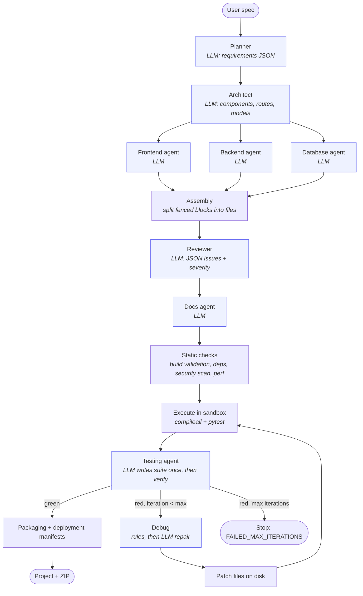

# AIForge

**A multi-agent system that turns a natural-language spec into a FastAPI + React project, runs the generated code in a Docker sandbox, and repairs it until its tests pass. A 20-task benchmark measures how well that works.**

[](LICENSE)


<!-- DEMO: add a ~2 minute recording (prompt -> generated project -> running app), e.g.
[](https://youtu.be/<id>)
-->

## Benchmark results

AIForge is measured on a fixed set of **20 tasks** (todo API, JWT auth, RBAC, bank ledger, e-commerce cart, job queue, …). Each generated project is **graded independently** of the pipeline's own claims: inside the sandbox, the grader checks whether the app boots, which required endpoints exist, and how many generated tests pass. [How it is measured →](docs/EVALUATION.md)

| Configuration | Build success | …before repair | Route coverage | Generated-test pass rate | Median tokens/task | Median time/task |
| --- | --- | --- | --- | --- | --- | --- |
| *not yet run: see below* | | | | | | |

Reproduce or extend these numbers:

```bash
docker build -t aiforge-sandbox:py311 sandbox/
AIFORGE_SANDBOX=docker python -m benchmarks.harness run --label baseline
python -m benchmarks.compare benchmarks/runs/*/results.json
```

Reviewer agent on 12 planted bugs + 3 clean controls: `python -m benchmarks.reviewer_eval` → recall _n/12_, false alarms _n/3_.

## How it works

The pipeline is a [LangGraph](https://langchain-ai.github.io/langgraph/) `StateGraph` (`backend/graph/parallel_workflow.py`). The diagram below is the actual graph; regenerate it with `python -c "from backend.graph.parallel_workflow import parallel_graph as g; print(g.get_graph().draw_mermaid())"`.



- **8 LLM agents plus an LLM repair step.** Planner, architect, frontend, backend and database generate the project; testing, reviewer and docs check and document it. The debugger uses rules first and falls back to an LLM patch.
- **Parallel fan-out.** Frontend, backend and database generation run concurrently once the architecture is fixed.
- **Sandboxed execution loop.** Generated code runs in Docker with no network, a read-only root filesystem, CPU/memory/PID limits, a non-root user, and a hard timeout. Failure output goes back to the debugger, and the loop repeats up to `max_iterations` (default 3).
- **Self-healing that knows when a fix didn't work.** Each patch is judged on per-test evidence from before and after the re-run (`fixed` / `improved` / `regressed` / `no_effect`). Regressions and no-ops are rolled back on disk, rejected patches are never re-applied, the LLM is told what it already tried, and the loop stops early after two non-improving attempts.
- **Evidence-backed verification.** Every project ships a `VERIFICATION.md` showing the command run, exit code, per-test outcomes, sandbox, and each repair attempt. The status is `VERIFIED` only if tests actually ran and all passed; "it compiles" is reported as `BUILD_ONLY`.
- **Observability.** Every LLM call and graph node emits a structured JSON event (agent, model, latency, provider-reported tokens, cache hit, fallback, error). Set `AIFORGE_TRACE_FILE=trace.jsonl` to log them.

## Design decisions

| Decision | Why | Trade-off |
| --- | --- | --- |
| **Local models via Ollama** with a per-task model router (`qwen2.5` for planning and docs, `qwen2.5-coder` for code) | free to run the full benchmark repeatedly; no code leaves the machine | weaker than frontier models; slower on a laptop |
| **Docker sandbox instead of a subprocess** | generated code is untrusted; stripping env vars doesn't stop file deletion, network calls or fork bombs | needs Docker; dependencies must be baked into the image because the network is off |
| **Grader independent of the pipeline** | a system that grades itself isn't evidence; the harness also counts how often the pipeline's "PASS" disagrees with the grader | extra sandbox runs per task |
| **Test suite frozen during repair**, and the debugger can't edit tests | otherwise a repair loop can "pass" by regenerating or weakening the tests | a bad generated test can block an otherwise-correct app |
| **LLM fallbacks invalidate a benchmark task** | the LLM layer returns canned placeholder code on failure, which could otherwise inflate success rates | Ollama outages show up as invalid tasks rather than failures |
| **Endpoints stated explicitly in benchmark prompts** | makes requirement coverage objectively measurable | measures following an explicit spec, not inferring one |

Each of these can be tested with the benchmark: `--model`, `--rag on|off`, `--llm-repair on|off`, `--max-iterations N`.

## Quick start

Prerequisites: Python 3.11+, Node 18+, [Ollama](https://ollama.com), and Docker (for the sandbox).

```bash
git clone https://github.com/SHASHANK8412/CodeForge-AI.git && cd CodeForge-AI
python -m venv venv && source venv/bin/activate        # Windows: venv\Scripts\activate
pip install -r requirements.txt

ollama pull qwen2.5 && ollama pull qwen2.5-coder        # default models (backend/config.py)
docker build -t aiforge-sandbox:py311 sandbox/           # isolated execution

# generate a project from the command line
AIFORGE_SANDBOX=docker python run_aiforge.py "Build a todo REST API with FastAPI and pytest tests"

# or run the web app
python -m uvicorn backend.main:app --reload --port 8000   # from the repo root
cd frontend && npm install && npm run dev                 # http://localhost:5173
```

Useful environment variables:

| Variable | Effect |
| --- | --- |
| `AIFORGE_SANDBOX=docker` | run generated code in the Docker sandbox (default: local subprocess) |
| `AIFORGE_CODING_MODEL`, `AIFORGE_GENERAL_MODEL` | override the routed models |
| `AIFORGE_RAG=off` | disable retrieval-augmented context in agent prompts |
| `AIFORGE_LLM_REPAIR=off` | debugger uses rules only |
| `AIFORGE_DISABLE_LLM_CACHE=1` | always call the model |
| `AIFORGE_TRACE_FILE=path.jsonl` | write structured agent/LLM traces |

## Tests

```bash
pytest tests/test_eval_harness.py   # harness, grader, sandbox, tracing, and an end-to-end run with a scripted LLM
pytest tests backend/tests          # full suite
```

`test_pipeline_end_to_end_repairs_planted_bug` runs the real LangGraph pipeline against a scripted LLM whose backend contains a bug. The generated tests catch it, the LLM repair step fixes it, and the grader confirms 2/3 → 3/3 passing tests.

## Self-healing demo

```text
generate ──► run tests in sandbox: 2/3 pass (GET /todos/999 returns 200, expected 404)
attempt 1 (LLM): patch backend/main.py ──► re-run: test_health now FAILS ──► verdict: regressed ──► ROLLED BACK
attempt 2 (LLM, told "attempt 1 broke test_health"): patch ──► re-run: 3/3 pass ──► verdict: fixed
VERIFICATION.md: ✅ VERIFIED (docker) · 3 passed · 2 attempts, 1 kept, 1 rolled back
```

This exact scenario runs as a test against the real LangGraph pipeline with a scripted LLM (`tests/test_self_healing_policy.py::test_regressing_patch_is_rolled_back_then_fixed`). With Ollama, the same flow runs against real model output via `python run_aiforge.py "..."`.

## Limitations

- **Backend-first.** Build success and tests cover the FastAPI backend; the React output isn't compiled in the sandbox (no network for `npm install`).
- **Small local models.** Results depend heavily on the model; compare configurations with `benchmarks.compare` before drawing conclusions, and run each configuration more than once (one task = 5 points).
- **Route coverage checks that endpoints exist, not that they behave correctly.** Behavior is only as well tested as the generated suite.
- **Python-only sandbox.** JavaScript projects are reported as unsupported in Docker mode rather than run unisolated.

## Repository layout

```
backend/graph/parallel_workflow.py   LangGraph pipeline (nodes, routing, repair loop)
backend/agents/                      agent prompts and parsing
backend/services/llm.py              Ollama client, model routing, retries, caching, tracing hooks
backend/execution/docker_sandbox.py  isolated execution
backend/observability/tracing.py     structured traces + per-run summaries
benchmarks/                          tasks, grader, harness, reviewer eval, comparison
sandbox/                             sandbox image definition
docs/EVALUATION.md                   methodology, metric definitions, caveats
```

## Project status

[`docs/AUDIT.md`](docs/AUDIT.md) lists every subsystem as verified, implemented, partial, simulated or missing, with the evidence for each. Some modules in this repo (cloud deployment pipeline, multi-provider gateway, SRE recovery) are still **simulated** and are marked as such there.

## License

[MIT](LICENSE). See also [ROADMAP.md](ROADMAP.md) and [DEPLOYMENT.md](DEPLOYMENT.md).
